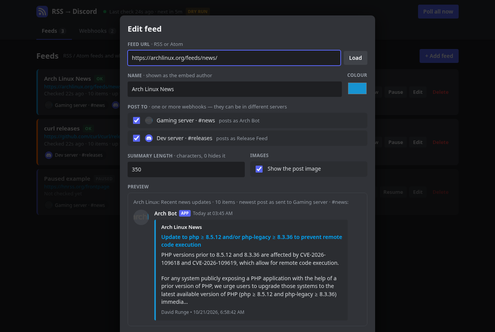

# rss-discord-bot

A small C++20 daemon that polls RSS / Atom feeds and posts new items to Discord
channels through **webhooks**, with a built-in **web dashboard** to manage
everything. No bot account or gateway connection is needed: each channel you
post to, in any server, is just a webhook URL.

- RSS 2.0, RSS 1.0 (RDF) and Atom 1.0
- **Web dashboard** (http://localhost:8080): add/edit/pause feeds, add webhooks for
  different servers with their own **display name and image**, live preview of
  the exact Discord message, "Send test", "Check now", activity and log views
- One feed can post to several webhooks (servers / channels) at once
- Rich embeds: title + link, plain-text summary (HTML stripped), author,
  timestamp, image (media:thumbnail, image enclosures or the first img in the post)
- **Posts page per feed**: every post currently in the feed with its status per webhook
  (posted / skipped / new), a Discord-style preview, and buttons to **repost one post** or
  **repost all** to any selection of webhooks (runs in the background, with progress and cancel)
- Remembers what it posted per feed and webhook (state.json): restarts never repost,
  a newly added webhook only gets the newest post instead of the whole backlog
- Conditional GET (ETag / Last-Modified), so unchanged feeds cost almost nothing
- Respects Discord rate limits (429 retry_after and the X-RateLimit bucket headers)
- Graceful shutdown on SIGINT / SIGTERM

## Build

Needs a C++20 compiler, CMake 3.25+ and libcurl. pugixml, nlohmann_json and
cpp-httplib are used from the system when installed and downloaded otherwise.

~~~sh
# Arch: sudo pacman -S --needed cmake curl pugixml nlohmann-json
# Debian/Ubuntu: sudo apt install cmake libcurl4-openssl-dev libpugixml-dev nlohmann-json3-dev
cmake -S . -B build
cmake --build build -j
ctest --test-dir build --output-on-failure
~~~

## Run

~~~sh
./build/rss-discord-bot            # creates config.json on first save, dashboard on :8080
~~~

Open http://localhost:8080/ and:

1. **Webhooks → Add webhook.** In Discord: *Server Settings → Integrations →
   Webhooks → New Webhook → Copy Webhook URL*, paste it and press *Check*: the
   bot asks Discord which server/channel it belongs to and fills in its name and
   avatar. Set the **label** (only shown in the dashboard), the **display name** posts
   appear under, and the **image** - either an image URL, or *Upload image...*
   which sets the webhook's own avatar on Discord. Repeat for every server/channel.
2. **Send test** to see a sample post in the channel.
3. **Feeds → Add feed**, paste the RSS/Atom URL, press *Load* to preview the newest
   post, pick which webhooks (servers) it goes to, and save. It is checked right away.
4. **Feeds → Posts** (or click a feed's name) lists every post in the feed. Each shows,
   per webhook, whether it was *posted* (and when), *skipped* (already in the feed when
   it was added, or over the per-check limit) or is *new* (goes out on the next check).
   Choose the webhooks under *Send to*, then press *Repost* on a post or *Repost all*.
   Reposts go out oldest first at the normal posting pace; long ones can be cancelled.

Everything you change in the dashboard is written to config.json (mode 600,
because webhook URLs contain tokens). The dashboard never sends a full webhook URL
back to the browser.

Options: `-c PATH` config file, `-p PORT` / `--bind ADDR` dashboard address,
`--no-dashboard`, `--once` (one round, no dashboard), `--dry-run` (print
payloads instead of posting), `--check` (validate config), `-v` debug logs.

### Dashboard security

By default the dashboard listens on 127.0.0.1 only and accepts only requests
addressed to localhost (blocks DNS-rebinding), and every change needs a custom
header (blocks cross-site requests). To reach it from another machine set a
password and bind address in config.json:

~~~json
"dashboard": { "enabled": true, "bind": "0.0.0.0", "port": 8080, "password": "long-random-string" }
~~~

The browser then asks for it (any user name). This is plain HTTP, so outside
your LAN put it behind a TLS reverse proxy (Caddy, nginx) or use SSH port
forwarding: `ssh -L 8080:localhost:8080 server`.

## Configuration file

The dashboard writes this for you; see [config.example.json](config.example.json).

~~~json
{
  "interval_seconds": 300,
  "webhooks": [
    { "id": "gaming-news", "name": "Gaming server · #news",
      "url": "https://discord.com/api/webhooks/ID/TOKEN",
      "username": "News Bot", "avatar_url": "https://example.com/bot.png" },
    { "id": "dev-releases", "name": "Dev server · #releases",
      "url": "env:DEV_RELEASES_WEBHOOK", "content": "<@&ROLE_ID> new release" }
  ],
  "feeds": [
    { "name": "Arch Linux News", "url": "https://archlinux.org/feeds/news/",
      "webhooks": ["gaming-news", "dev-releases"], "color": "#1793D1" }
  ]
}
~~~

| Setting | Default | Meaning |
| --- | --- | --- |
| `interval_seconds` | 300 (min 30) | Time between checks |
| `max_posts_per_poll` | 5 | Cap per feed and webhook per check; older extras are marked seen |
| `first_run_posts` | 1 | When a feed/webhook pair is new, post only its newest N items (0 = none) |
| `post_delay_ms` | 1000 | Pause between posts |
| `username`, `avatar_url` | `RSS`, none | Defaults for webhooks without their own |
| `color` | `#5865F2` | Default embed colour for new feeds |
| `state_file` | `state.json` | Relative paths are resolved next to the config file |
| `dashboard` | on, 127.0.0.1:8080 | `enabled`, `bind`, `port`, `password` |

**Webhook** fields: `id`, `name` (dashboard label), `url` (or
`env:VARIABLE` to read it from the environment), `username` and
`avatar_url` (name/image on posts), `thread_id` (post into a thread or forum
post), `content` (text above each embed - the only place role/user mentions
can ping, and they are per server, which is why this lives on the webhook).
Discord rejects display names containing "discord" or "clyde".

**Feed** fields: `id`, `name` (embed author, defaults to the feed title),
`url`, `webhooks` (list of webhook ids), `color`, `summary_length`
(0-4096, 0 hides the description), `show_image`, `enabled`.

Configs from version 1 (a single `webhook_url`, or `DISCORD_WEBHOOK_URL`
in the environment) still load; they become a webhook called "default".

## Run as a service

See [contrib/rss-discord-bot.service](contrib/rss-discord-bot.service) for a
systemd user unit.

## How it decides what is new

Each item is identified by its guid / Atom id (falling back to the link). For
every feed + webhook pair the posted IDs are stored in the state file (up to
1000, or 3x the feed size). Items are posted oldest first. If a post fails
(network, 5xx, deleted webhook) the item stays unposted and is retried on the
next check; if Discord rejects the payload itself (HTTP 400) the item is skipped
and logged.

## Layout

~~~
src/main.cpp        CLI, startup
src/app.*           polling loop, new-item logic, repost job queue, live config + status
src/dashboard.*     web server + JSON API (cpp-httplib)
web/index.html      the dashboard UI (embedded into the binary at build time)
src/feed.*          RSS / Atom parsing (pugixml)
src/discord.*       embeds, webhook client, rate limits, webhook info/avatar API
src/http.*          libcurl wrapper
src/state.*         seen-item store (atomic JSON writes)
src/config.*        config load/save/validation, v1 migration
src/util.*          HTML-to-text, dates, UTF-8 truncation, URL resolving, logging
tests/              self-contained unit tests (ctest)
~~~
